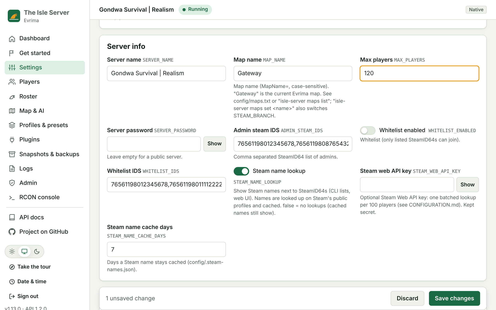
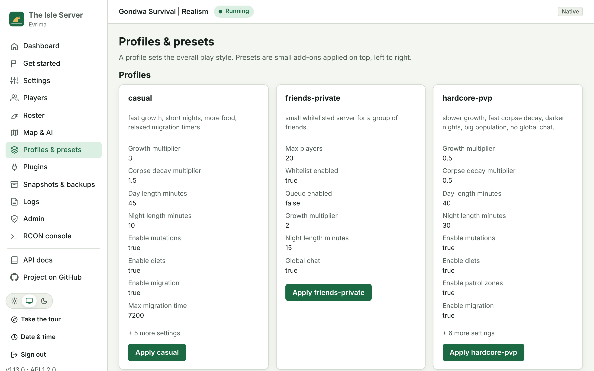
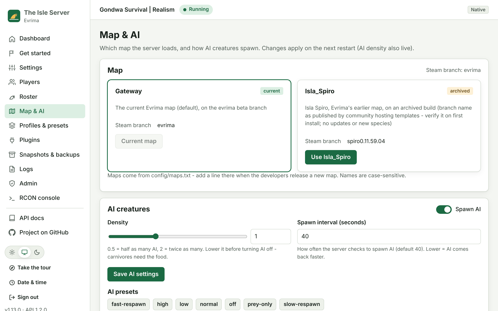
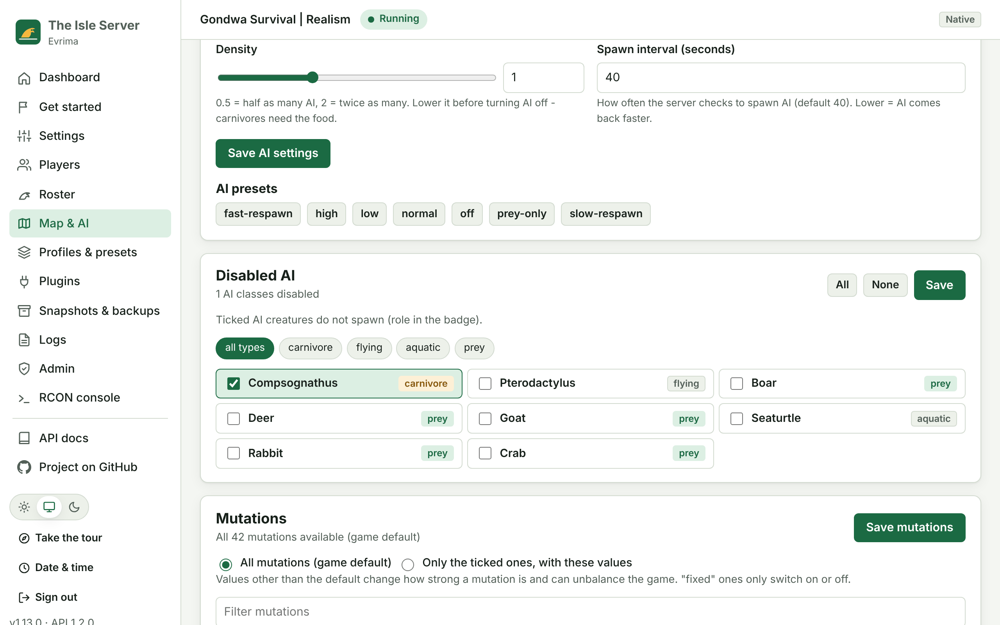
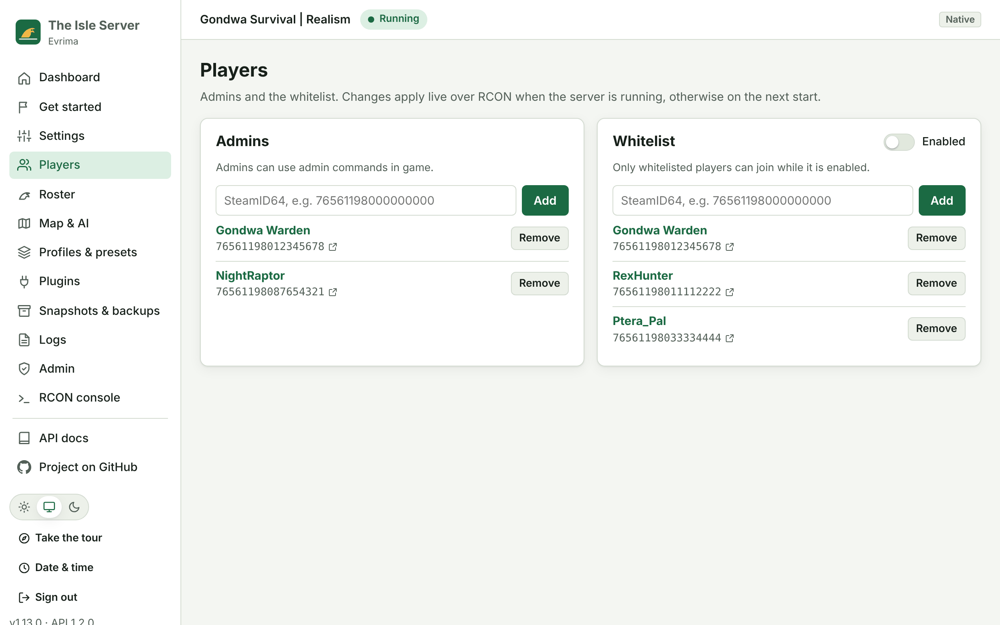
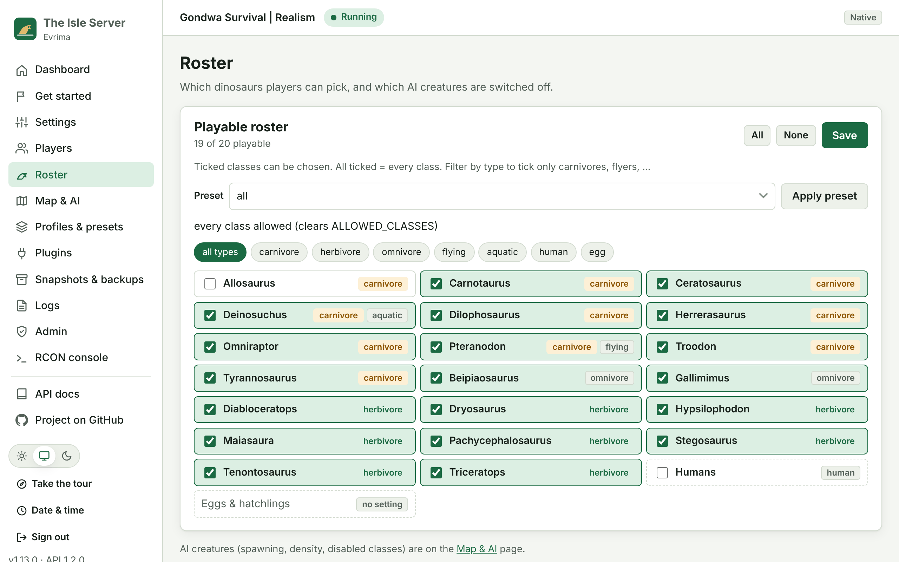
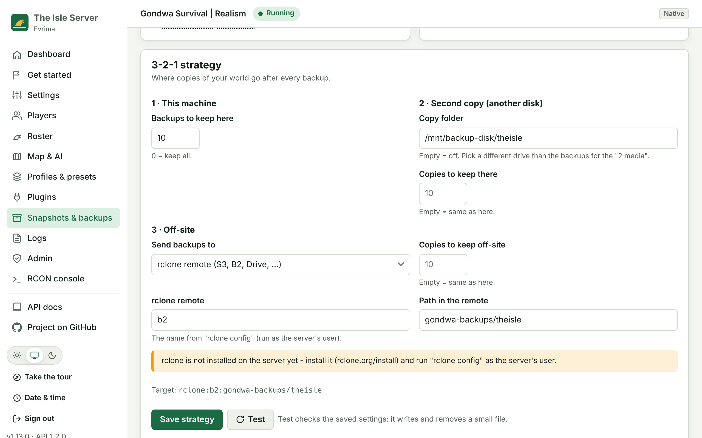

# Configuration Reference

All settings live in **`config/server.conf`**, which the installers create from
`config/server.conf.example`. The Linux and Windows scripts share the same file.

Format: `KEY=value`, one per line, `#` for comments, optional double quotes. Lists are
comma-separated. Restart the server after editing.

When `MANAGE_INI_FILES=true` (the default), the scripts regenerate the server's ini files on
every start and keep the previous copy as `*.bak`:

| OS | Path |
|---|---|
| Linux | `<SERVER_DIR>/TheIsle/Saved/Config/LinuxServer/Game.ini` and `Engine.ini` |
| Windows | `<SERVER_DIR>\TheIsle\Saved\Config\WindowsServer\Game.ini` and `Engine.ini` |

If you prefer to edit the `.ini` files by hand, set `MANAGE_INI_FILES=false`. The scripts
then generate them only if they don't exist yet.

You can also change settings in the optional [web UI](UI.md). Every key is shown with its description, and
changes are checked before they are saved:



## Profiles and presets



**Profiles** are complete play styles. **Presets** are small changes you can stack. Applying either writes
its keys into `server.conf`, keeps a timestamped backup, validates, and rolls back if the result is invalid.
Restart the server afterwards.

| Profile | Style |
|---|---|
| `vanilla` | The standard Evrima defaults |
| `realism` | Slow growth, long days and nights, no global chat |
| `casual` | Fast growth, short nights, more food |
| `hardcore-pvp` | Slow growth, fast corpse decay, 150 players, no global chat |
| `friends-private` | 20 players, whitelist on, no queue |
| `sandbox` | Very fast growth, humans on, no diets or migration |
| `performance` | Fewer AI, plants and players, 30 Hz tick |

Presets: `ai-off`, `ai-low`, `ai-high`, `fast-growth`, `very-fast-growth`, `slow-growth`, `humans-on`,
`humans-off`, `no-migration`, `short-nights`, `long-days`, `static-weather`, `whitelist-on`, `whitelist-off`,
`global-chat-off`, `global-chat-on`, `mutations-off`, `diets-off`, `queue-off`, `more-food`,
`region-spawning`, `replays-off`.

```bash
isle-server profile list
isle-server profile show realism          # current -> new value for every key
isle-server profile apply realism
isle-server preset apply ai-low short-nights fast-growth   # applied left to right
```

Windows: `IsleServer.ps1 Profile apply realism`, `IsleServer.ps1 Preset apply ai-low short-nights`
(or `Manage.bat Profile apply realism`).

Profiles never touch names, passwords or ports. Your own profiles and presets are just `KEY=VALUE` files in
`config/profiles/` and `config/presets/`. The first comment line is the description.

## Maps

| Linux | Windows | Effect |
|---|---|---|
| `isle-server maps list` | `Manage.bat Maps list` | Known maps from `config/maps.txt`, the current one marked `*` |
| `isle-server maps show [name]` | `Manage.bat Maps show Isla_Spiro` | Branch, status and description |
| `isle-server maps set <name> [--keep-branch]` | `Manage.bat Maps set Isla_Spiro` | Sets `MAP_NAME` and the map's `STEAM_BRANCH`. If the branch changes, stop the server and run `validate` |

| Map | `MAP_NAME` | Steam branch | Status |
|---|---|---|---|
| Gateway | `Gateway` | `evrima` | current, default |
| Isla Spiro | `Isla_Spiro` | `spiro0.11.59.04` | archived build: no updates or new species |

Map names are case-sensitive. There is no official map list; the Isla Spiro branch name comes from community hosting
templates, so verify it on first install. When the developers release a new map, add a line to `config/maps.txt`
(`NAME  BRANCH  STATUS  description`); a `MAP_NAME` that isn't listed only produces a warning in `check`. The web UI
has a **Map & AI** page for the same things:



## AI creatures

| Linux | Windows | Effect |
|---|---|---|
| `isle-server ai status` | `Manage.bat AI status` | Spawning, density, spawn interval and disabled classes |
| `isle-server ai on\|off` | `Manage.bat AI off` | `SPAWN_AI` (next restart) |
| `isle-server ai density 0.5` | `Manage.bat AI density 0.5` | `AI_DENSITY`, also applied live over RCON (`aidensity`) |
| `isle-server ai interval 25` | `Manage.bat AI interval 25` | `AI_SPAWN_INTERVAL`, the seconds between spawn checks (next restart) |
| `isle-server ai preset ai-prey-only` | `Manage.bat AI preset ai-prey-only` | Applies an `ai-*` preset |
| `isle-server ai-classes set Boar Deer` | `Manage.bat AIClasses set Boar Deer` | `DISABLED_AI_CLASSES`, live over RCON |

AI presets: `ai-normal`, `ai-low`, `ai-high`, `ai-off`, `ai-fast-respawn` (20 s), `ai-slow-respawn` (90 s) and
`ai-prey-only` (no Compsognathus or Pterodactylus). The AI classes and their roles are listed in `config/classes.txt`:

| Class | Role |
|---|---|
| Compsognathus | carnivore |
| Pterodactylus | flying |
| Boar, Deer, Goat | prey |
| Seaturtle | aquatic |

Lower the density before you turn AI off: carnivores live on AI.



## Admins, whitelist and playable roster

In the [web UI](UI.md) these are the **Players** and **Roster** pages:

| Players | Roster |
|---|---|
|  |  |

| Linux | Windows | Effect |
|---|---|---|
| `isle-server admins list\|add\|remove <SteamID64...>` | `IsleServer.ps1 Admins add <id...>` | `ADMIN_STEAM_IDS`. Applies on restart |
| `isle-server whitelist list\|add\|remove <id...>\|on\|off` | `IsleServer.ps1 Whitelist add <id...>` | `WHITELIST_IDS` / `WHITELIST_ENABLED`. **Live** via RCON |
| `isle-server classes list\|known\|set\|add\|remove <Class...>\|reset\|preset [roster]` | `IsleServer.ps1 Classes ...` | `ALLOWED_CLASSES`. **Live** via RCON `updateplayables` |
| `isle-server ai-classes list\|known\|set\|add\|remove\|reset` | `IsleServer.ps1 AIClasses ...` | `DISABLED_AI_CLASSES`. **Live** via RCON |

- SteamIDs must be SteamID64s (17 digits starting with `7656119`). Duplicates are dropped.
- Class names are checked against [`config/classes.txt`](config/classes.txt). Unknown names only warn, so new
  species keep working. Edit that file when a patch adds or renames one.
- **Roster presets** live in [`config/rosters/`](config/rosters/): `all`, `carnivores`, `herbivores`,
  `no-apex`, `small-only`, `beginner`.
- When the server is running and RCON is enabled, whitelist and roster changes are also sent live. Otherwise
  they apply on the next start. In docker mode the live change goes through the container.

### Steam names for SteamID64s

The admin and whitelist lists show each player's Steam name next to the SteamID64, in the CLI and in the web UI,
and adding a player prints who you added:

```text
$ isle-server admins add 76561198012345678
[ OK ] Admins: 1 - restart the server to apply (the game reads admins at start)
  76561198012345678  Gondwa Warden
$ isle-server admins list            # --refresh asks Steam again instead of using the cache
$ isle-server steam names 76561198012345678 76561198087654321
```

On Windows: `IsleServer.ps1 Admins list`, `Whitelist add <id>`, `Steam names <id...>`.

| Key | Default | Meaning |
|---|---|---|
| `STEAM_NAME_LOOKUP` | `true` | Look names up on Steam. `false` = no requests (names already cached still show) |
| `STEAM_WEB_API_KEY` | (empty) | Optional [Steam Web API key](https://steamcommunity.com/dev/apikey): one batched call per 100 players instead of one profile page each. Masked in the UI |
| `STEAM_NAME_CACHE_DAYS` | `7` | How long a name is cached in `config/.steam-names.json` |

Without a key, names come from each public profile (`steamcommunity.com/profiles/<id>?xml=1`). A private profile
or an ID with no Steam account shows "(name unknown)". A lookup never fails a command: when Steam can't be reached,
the last known name is shown. Names are what players call themselves on Steam and can change at any time; the
SteamID64 is what the server uses.

### First-time setup and recommended settings

`isle-server setup` (Windows: `IsleServer.ps1 Setup`) is a short wizard for a new server. It checks this machine,
recommends settings that fit it, then asks for the server name, join password, map, max players, your SteamID64 as
admin, a play-style profile, the backup schedule and the 3-2-1 targets, and finishes with `check`. Press Enter to keep
a value. `setup --yes` uses the recommendations and defaults without asking. The web UI has the same wizard on its
**Get started** page.

`isle-server recommend` shows the machine and the recommendations on their own; `recommend --apply [KEY...]` applies
them (all, or only the keys you name):

```text
Machine   : Linux x86_64, 8 CPU threads (AMD Ryzen 7 5800X 8-Core Processor)
Memory    : 16 GB, 13.2 GB available
Disk      : 240 GB free at /home/theisle
Fits      : a large server, about 100 players

Setting            Recommended    Current        Why
MAX_PLAYERS        100            100            About 100 players fit 16 GB of memory and 8 CPU threads ...
AI_DENSITY         1              1              The machine has room for the default amount of AI.
NET_TICK_RATE      30             (default)      30 Hz is smooth and affordable with 4+ CPU threads.
BACKUP_RETENTION   30             10             30 backups of ~180 MB use at most a quarter of the free disk ...
BACKUP_SCHEDULE    0 */6 * * *    0 5 * * *      Busy servers lose less progress with a backup every 6 hours.
```

The developers publish no official server requirements, so these are estimates from community experience: about
2.5 GB of memory for an empty server plus ~60 MB per player, a CPU thread per ~25 players (at most 100 players), and
~20 GB of disk for the game files. A container memory limit counts, and non-x86_64 machines, less than ~6 GB of
memory and too little disk get a warning. Watch real usage and adjust.

### Roster by type, humans and eggs

Each playable class in [`config/classes.txt`](config/classes.txt) has one or more types: `carnivore`, `herbivore`,
`omnivore`, `flying`, `aquatic`.

| Linux | Windows | Effect |
|---|---|---|
| `isle-server classes types` | `IsleServer.ps1 Classes types` | Lists the classes of each type |
| `isle-server classes select carnivore [flying ...]` | `Classes select ...` | Only those types are playable |
| `isle-server classes add-type herbivore` / `remove-type flying` | `Classes add-type` / `remove-type` | Adds or removes a whole type |
| `isle-server classes humans on\|off` | `Classes humans on` | `ENABLE_HUMANS` (live via RCON `togglehumans`) |

Humans are not a class: one switch turns them on or off. Eggs and hatchlings are not a class either and the server
has no setting for them. The UI roster has filters for every type plus **human** and **egg**, with **Only**, **Add**
and **Remove** buttons for the type in view.

## Mutations

`ENABLE_MUTATIONS` turns the mutation system on or off. `ENABLED_MUTATIONS` picks which mutations exist and how strong
they are. When it is empty (the default), every mutation is available at the game's values. When it lists any, only
those are available, written to `Game.ini` as `EnabledMutations=Name, value` lines.

| Linux | Windows |
|---|---|
| `isle-server mutations list` | `IsleServer.ps1 Mutations list` |
| `isle-server mutations enable Hemomania 0.1` | `Mutations enable Hemomania 0.1` |
| `isle-server mutations disable Wader Featherweight` | `Mutations disable ...` |
| `isle-server mutations reset` (all, game default) | `Mutations reset` |

The names and defaults come from [`config/mutations.txt`](config/mutations.txt). "Fixed" mutations only take `1`.
Values other than the default warn: they can make gameplay unstable. The UI has a **Mutations** card on the Map & AI page.

## Admin commands (live, over RCON)

`isle-server admin <action>` / `IsleServer.ps1 Admin <action>` and the UI **Admin** page send live commands to a
running server with RCON enabled:

| Action | What it does |
|---|---|
| `players`, `player [SteamID64]`, `details`, `queue`, `playables` | Players online, a player's data, server details, queue status, playable classes |
| `announce <text>`, `dm <id> <text>` | Message everyone, or one player |
| `kick <id> [reason]`, `ban <id> [reason]` | Kick or ban (sent as `id,reason`) |
| `save`, `wipecorpses` | Save the world, remove every corpse |
| `pause`, `migrations`, `humans`, `chat`, `ai-learning`, `netupdate` `on\|off` | Live switches (reset to server.conf on restart) |
| `growth on\|off\|<multiplier>` | Growth multiplier, e.g. `growth 1.5` |
| `custom "<command>"` | Experimental raw command |

Evrima's RCON has **no** commands to change a player's size or growth stage, skin, or mutations, to give god mode, or
to teleport or heal. Admins listed in `ADMIN_STEAM_IDS` do those in game with the game's own admin panel.

## Any Game.ini / Engine.ini key (overrides)

Put `Game.ini` and/or `Engine.ini` in `config/overrides/` (or the folder set in `INI_OVERRIDES_DIR`).
They are merged into the generated files on every start:

- `Key=Value` **replaces every generated line** of that key in that section. Repeat the key for lists.
- New keys are added to their section, and new sections are appended.
- Lines starting with `+`, `-` or `!` (Unreal array syntax) pass through unchanged.

Examples: [`config/examples/overrides/`](config/examples/overrides/). Every known key, with its section, default,
`server.conf` key and status: [`config/reference/Game.ini.md`](config/reference/Game.ini.md) and
[`config/reference/Engine.ini.md`](config/reference/Engine.ini.md). In docker mode the folder is mounted
read-only into the container.

### Optional / advanced keys

Written only when set:

| server.conf | ini key | Notes |
|---|---|---|
| `REGION_SPAWNING` | `bUseRegionSpawning` | community-documented |
| `REGION_SPAWN_COOLDOWN` | `bUseRegionSpawnCooldown` | community-documented |
| `REGION_SPAWN_COOLDOWN_SECONDS` | `RegionSpawnCooldownTimeSeconds` | community-documented |
| `WEATHER_MIN_INTERVAL` / `WEATHER_MAX_INTERVAL` | `Min/MaxWeatherVariationInterval` | community-documented |
| `NET_TICK_RATE` | Engine.ini `NetServerMaxTickRate` | Unreal Engine |
| `INI_OVERRIDES_DIR` | (override folder) | default `config/overrides` |

## Validation (`check`)

Run `isle-server check` (Linux) or `IsleServer.ps1 Check` (Windows) after you edit the file.
`configure`, `run`, `start` and `install` run the same checks and won't launch while there are errors.

| Severity | Condition |
|---|---|
| Error | `GAME_PORT`, `QUEUE_PORT` or `RCON_PORT` isn't 1–65535, or two enabled ports are the same |
| Error | `MAX_PLAYERS` isn't a positive integer |
| Error | A true/false setting has another value (allowed: true, false, yes, no, 1, 0, on, off) |
| Error | A multiplier, density or day/night length isn't a number, or a time/retention value isn't a whole number |
| Error | `RCON_ENABLED=true` and `RCON_PASSWORD` is empty |
| Error | `EOS_CLIENT_ID` or `EOS_CLIENT_SECRET` is empty |
| Warning | An `ADMIN_STEAM_IDS` / `WHITELIST_IDS` entry isn't a 17-digit SteamID64 |
| Warning | `SERVER_NAME` is empty, or the whitelist is on with no IDs |

Exit code: `0` = OK (warnings allowed), `1` = errors.

## Runtime

| Key | Default | Description |
|---|---|---|
| `RUNTIME` | `native` | `native` = run on this machine. `docker` = the launcher manages a container ([DOCKER.md](DOCKER.md)) |
| `DOCKER_BUILD` | `true` | Docker: build the image from this repo. `false` = use `DOCKER_IMAGE` as is (pulled if missing) |
| `DOCKER_IMAGE` | `theisle-server:latest` | Docker: image name / reference |
| `PUID` / `PGID` | `1000` | Docker: uid/gid the server runs as inside the container |

To override per command: `isle-server.sh --docker|--native <cmd>`, `IsleServer.ps1 <Cmd> -Runtime Docker|Native`,
or the `ISLE_RUNTIME` environment variable (precedence: flag > env > config).
In docker mode, `STEAMCMD_DIR`, `SERVER_DIR` and `BACKUP_DIR` are ignored. The container always uses `/data`.

## Install and update

| Key | Default | Description |
|---|---|---|
| `STEAMCMD_DIR` | `~/steamcmd` / `C:\TheIsle\steamcmd` | SteamCMD location |
| `SERVER_DIR` | `~/theisle-server` / `C:\TheIsle\server` | Server install directory |
| `BACKUP_DIR` | `~/theisle-backups` / `C:\TheIsle\backups` | Backup destination |
| `STEAM_APP_ID` | `412680` | The Isle Dedicated Server app |
| `STEAM_BRANCH` | `evrima` | Beta branch; empty for public/Legacy |
| `STEAM_BRANCH_PASSWORD` | | Only for password-protected branches |
| `VALIDATE_ON_UPDATE` | `false` | Verify all files on each update |
| `UPDATE_ON_START` | `true` | Run SteamCMD before every start |

## Network

| Key | Default | Description |
|---|---|---|
| `GAME_PORT` | `7777` | Passed as `-Port=`; open UDP (and TCP) |
| `QUEUE_PORT` | `10000` | `QueuePort`; TCP |
| `RCON_PORT` | `8888` | `RconPort`; TCP. Keep it private |
| `MULTIHOME_IP` | | Passed as `-MultiHome=` to bind one interface |
| `FIREWALL_OPEN_RCON` | `false` | Also open RCON in the OS firewall |

## Server settings → `[/Script/TheIsle.TIGameSession]`

| server.conf | Game.ini key | Default |
|---|---|---|
| `SERVER_NAME` | `ServerName` | `My Evrima Server` |
| `MAP_NAME` | `MapName` | `Gateway` |
| `MAX_PLAYERS` | `MaxPlayerCount` (+ `[/Script/Engine.GameSession] MaxPlayers`) | `100` |
| `SERVER_PASSWORD` | `bServerPassword` + `ServerPassword` | empty (public) |
| `QUEUE_ENABLED` | `bQueueEnabled` | `true` |
| `RCON_ENABLED` | `bRconEnabled` | `true` |
| `RCON_PASSWORD` | `RconPassword` | random (installer) |
| `WHITELIST_ENABLED` | `bServerWhitelist` | `false` |
| `GLOBAL_CHAT` | `bEnableGlobalChat` | `true` |
| `ENABLE_HUMANS` | `bEnableHumans` | `false` |
| `DYNAMIC_WEATHER` | `bServerDynamicWeather` | `true` |
| `DAY_LENGTH_MINUTES` | `ServerDayLengthMinutes` | `45` |
| `NIGHT_LENGTH_MINUTES` | `ServerNightLengthMinutes` | `20` |
| `GROWTH_MULTIPLIER` | `GrowthMultiplier` | `1` |
| `CORPSE_DECAY_MULTIPLIER` | `CorpseDecayMultiplier` | `1` |
| `ENABLE_MUTATIONS` | `bEnableMutations` | `true` |
| `ENABLE_DIETS` | `bEnableDiets` | `true` |
| `ENABLE_PATROL_ZONES` | `bEnablePatrolZones` | `true` |
| `ALLOW_RECORDING_REPLAY` | `bAllowRecordingReplay` | `true` |
| `SPAWN_PLANTS` | `bSpawnPlants` | `true` |
| `PLANT_SPAWN_MULTIPLIER` | `PlantSpawnMultiplier` | `1` |
| `SPAWN_AI` | `bSpawnAI` | `true` |
| `AI_DENSITY` | `AIDensity` | `1` |
| `AI_SPAWN_INTERVAL` | `AISpawnInterval` | `40` |
| `DISABLED_AI_CLASSES` | `DisallowedAIClasses=` (one line each) | empty |
| `ENABLE_MIGRATION` | `bEnableMigration` | `true` |
| `MAX_MIGRATION_TIME` | `MaxMigrationTime` | `5400` |
| `ENABLE_MASS_MIGRATION` | `bEnableMassMigration` | `true` |
| `MASS_MIGRATION_TIME` | `MassMigrationTime` | `43200` |
| `MASS_MIGRATION_DISABLE_TIME` | `MassMigrationDisableTime` | `7200` |
| `ALLOWED_CLASSES` | `AllowedClasses=` (one line each) | empty = all |
| `ADMIN_STEAM_IDS` | `AdminsSteamIDs=` (one line each) | empty |
| `WHITELIST_IDS` | `WhitelistIDs=` (one line each) | empty |
| `EXTRA_GAME_SESSION_SETTINGS` | appended verbatim, `|`-separated | empty |

`AdminsSteamIDs` and `WhitelistIDs` are also written to `[/Script/TheIsle.TIGameStateBase]`,
because different Evrima builds have read them from either section.

Use **SteamID64** values (17 digits, starting with `7656119`). You can look them up on steamid.io.

### Example generated `Game.ini`

```ini
[/Script/TheIsle.TIGameSession]
ServerName=My Evrima Server
MapName=Gateway
MaxPlayerCount=100
bServerPassword=false
ServerPassword=
bQueueEnabled=true
QueuePort=10000
bRconEnabled=true
RconPassword=ChangeMe123
RconPort=8888
bServerWhitelist=false
bEnableGlobalChat=true
bEnableHumans=false
bServerDynamicWeather=true
ServerDayLengthMinutes=45
ServerNightLengthMinutes=20
GrowthMultiplier=1
CorpseDecayMultiplier=1
bEnableMutations=true
bEnableDiets=true
bEnablePatrolZones=true
bAllowRecordingReplay=true
bSpawnPlants=true
PlantSpawnMultiplier=1
bSpawnAI=true
AIDensity=1
bEnableMigration=true
MaxMigrationTime=5400
bEnableMassMigration=true
MassMigrationTime=43200
MassMigrationDisableTime=7200
AdminsSteamIDs=76561198000000001

[/Script/TheIsle.TIGameStateBase]
AdminsSteamIDs=76561198000000001

[/Script/Engine.GameSession]
MaxPlayers=100
```

## Epic Online Services → `Engine.ini`

Evrima servers register through EOS. Without these keys the server starts but doesn't show
up in the server browser.

| server.conf | Engine.ini |
|---|---|
| `EOS_CLIENT_ID` | `[EpicOnlineServices] DedicatedServerClientId` |
| `EOS_CLIENT_SECRET` | `[EpicOnlineServices] DedicatedServerClientSecret` |

The defaults are the public dedicated-server credentials that community guides publish.
Replace them only if the developers announce new values.

## Script behaviour

| Key | Default | Description |
|---|---|---|
| `MANAGE_INI_FILES` | `true` | Regenerate ini files from server.conf on every start |
| `EXTRA_ARGS` | `-log` | Extra command-line arguments for the server |
| `STOP_TIMEOUT` | `60` | Seconds to wait for a graceful exit before killing |
| `AUTO_RESTART` | `true` | Restart after a crash (watchdog mode) |
| `BACKUP_RETENTION` | `10` | Local backup archives to keep (0 = all). Also the default for the second copy and off-site |
| `BACKUP_SCHEDULE` | `0 5 * * *` | When the scheduled task backs up: cron syntax, `@daily`/`@hourly`/..., or `off` |
| `BACKUP_COPY_DIR` | (empty) | Second copy of every backup, ideally on another disk or a network share (3-2-1) |
| `BACKUP_COPY_RETENTION` | (empty) | Copies kept in `BACKUP_COPY_DIR` (empty = `BACKUP_RETENTION`) |
| `BACKUP_OFFSITE_TARGET` | (empty) | Off-site copy: `dir:<path>`, `rclone:<remote>:<path>` or `ssh://[user@]host[:port]/path` |
| `BACKUP_OFFSITE_RETENTION` | (empty) | Copies kept off-site (empty = `BACKUP_RETENTION`) |
| `BACKUP_OFFSITE_COMMAND` | (empty) | Advanced, server.conf only: a command run after every backup; `{file}` is the archive |
| `SAVE_BEFORE_STOP` | `true` | Send RCON `save` before stopping or backing up |

### Scheduled backups and the 3-2-1 rule

The installers add a per-minute task (systemd `theisle-server-backup.timer`, or the `TheIsleServer-Backup` scheduled
task on Windows) that runs `backup tick`. It backs up when `BACKUP_SCHEDULE` falls due, at most once per due minute,
and catches up on a minute missed while the machine was busy.

`BACKUP_SCHEDULE` uses the five cron fields `minute hour day-of-month month day-of-week`, in the server's
`TIMEZONE`. Lists (`1,15`), ranges (`1-5`), steps (`*/15`), names (`MON-FRI`, `JAN`) and `@hourly`, `@daily`,
`@weekly`, `@monthly`, `@yearly` work; `off` turns scheduled backups off. Examples:

| Schedule | Meaning |
|---|---|
| `0 5 * * *` | Every day at 05:00 (default) |
| `0 */6 * * *` | Every 6 hours |
| `30 4 * * MON-FRI` | Weekdays at 04:30 |
| `0 5,17 * * *` | 05:00 and 17:00 |

```bash
isle-server backup schedule set "0 */6 * * *"   # validated before it is saved
isle-server backup schedule show                # the next runs
isle-server backup status                       # last backup and the 3-2-1 check (--json for scripts)
```

### Your 3-2-1 strategy

**3-2-1** means 3 copies of your data, on 2 different media, 1 of them off-site. The live world is one copy and
`BACKUP_DIR` the second. Add a second copy on another disk (the "2 media") and an off-site copy (the "1 off-site")
with `backup strategy`, or in the web UI on **Snapshots & backups → 3-2-1 strategy**:



```bash
isle-server backup strategy                                         # what is set up now
isle-server backup strategy keep 14                                 # local backups to keep
isle-server backup strategy copy /mnt/backup-disk/theisle --keep 7  # second copy, on another disk
isle-server backup strategy offsite rclone:b2:my-bucket/theisle --keep 30
isle-server backup strategy test                                    # check both (writes and removes a probe file)
isle-server backup strategy offsite off                             # turn a part off
```

On Windows: `IsleServer.ps1 Backup strategy copy E:\TheIsleBackups`, `Backup strategy offsite dir:\\nas\share\theisle`,
`Backup strategy test`.

| Off-site target | Example | Needs |
|---|---|---|
| A folder: a mounted network share, another machine's share, a synced folder | `dir:/mnt/nas/theisle`, `dir:\\nas\share\theisle` | The share mounted / reachable for the server's user |
| An [rclone](https://rclone.org) remote: S3, Backblaze B2, Google Drive, OneDrive, SFTP, ... | `rclone:b2:my-bucket/theisle` | rclone installed, and `rclone config` run as the server's user |
| Another machine over SSH | `ssh://backup@nas.lan:2222/srv/theisle` | The OpenSSH client and key-based login for the server's user |

After every backup the archive is copied to each part, and old copies there are pruned to their "keep" count (only
files named `theisle-*`). Targets are validated strictly and run without a shell, which is why the web UI may set
them. `BACKUP_OFFSITE_COMMAND` (server.conf only) still runs any command you like after each backup, and the
`offsite-backup` plugin is another option. An off-site step has a one-hour limit; a failure only warns, and
`backup status` shows the result of the last one. `backup status` (and the UI) warn when the second copy or a `dir:`
target sits on the same disk as `BACKUP_DIR`.

## Logs and time

| Key | Default | Description |
|---|---|---|
| `TIMEZONE` | `local` | `local` or `utc`: the clock for log timestamps and for the `_yyyymmdd_hhmmss` suffix of dated files |
| `LOG_DIR` | *(empty)* | Folder for log files. Empty = `<scripts>/logs` (Docker: `/data/logs`). Machine-specific |
| `LOG_RETENTION` | `14` | Log files kept per kind (`launcher`, `server`, `ui`), and the game's own `TheIsle-backup-*.log`. `0` = keep all |
| `LOG_MAX_SIZE_MB` | `20` | A new log file starts once the current one is bigger than this. `0` = no limit |

Every log file is named `KIND_yyyymmdd_hhmmss.log`, for example `server_20261108_143000.log` (a second file in the
same second gets `_1`, `_2` ...). Dated files use the same suffix:

| File | Name |
|---|---|
| Backups | `theisle-backup_20261108_143000.tar.gz` (Windows `.zip`) |
| Final backup on uninstall | `theisle-final_20261108_143000.tar.gz` |
| Snapshots | `theisle-snapshot_20261108_143000.tar.gz` |
| Replaced world | `Saved.pre-restore_20261108_143000`, `Saved.pre-snapshot_20261108_143000` |
| Config backup | `server.conf.bak_20261108_143000` |

Files with the older `-yyyymmdd-hhmmss` names are still found, restored and pruned. In Docker mode with `TIMEZONE=local`
the container gets the host's UTC offset. The web UI has its own per-browser **Date & time** setting (server time,
browser time or UTC, and the date format); see [UI.md](UI.md).

## Web UI

Used by `isle-server ui` / `IsleServer.ps1 UI` and the `theisle-ui` service (see [UI.md](UI.md)). Both keys are
machine-specific: the UI shows them read-only, and snapshots don't carry them.

| Key | Default | Description |
|---|---|---|
| `UI_HOST` | `127.0.0.1` | Address the web UI and API listen on. Keep `127.0.0.1` and use an SSH tunnel or a TLS reverse proxy for remote access |
| `UI_PORT` | `8090` | Port of the web UI and API (`check` validates it) |

## RCON

`tools/isle_rcon.py` speaks the Evrima binary RCON protocol. It needs Python 3.6+ and no extra packages.

```
isle-server rcon announce "Server restart in 10 minutes"     # Linux wrapper
python3 tools/isle_rcon.py -c config/server.conf playerlist  # direct
python3 tools/isle_rcon.py -P secret kick 76561198000000001,AFK
python3 tools/isle_rcon.py -P secret raw 0x12                # arbitrary command byte
```

Commands: `announce`, `directmessage`, `serverdetails`, `wipecorpses`, `updateplayables`, `ban`,
`kick`, `playerlist`, `save`, `playerdata`, `togglewhitelist`, `addwhitelist`, `removewhitelist`,
`toggleglobalchat`, `togglehumans`, `toggleai`, `disableaiclasses`, `aidensity`, `raw`.

The command bytes come from community documentation and may change with game updates.

## Scheduled restarts (optional)

- **Linux:** `sudo systemctl edit theisle-server`, or add a root cron entry:
  `0 6 * * * systemctl restart theisle-server`
- **Windows:** create a daily task that runs
  `C:\TheIsle\scripts\windows\Restart.bat` with the environment variable `ISLE_NOPAUSE=1` set.

---

Made with ❤️ by [Kyros Koh](https://github.com/kyroskoh)
