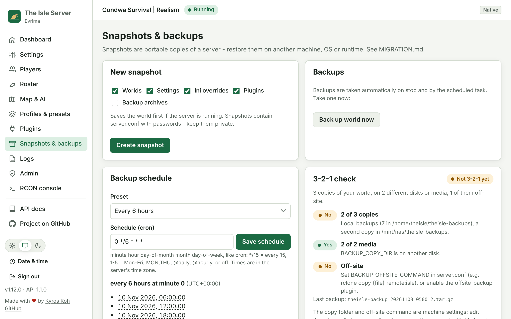
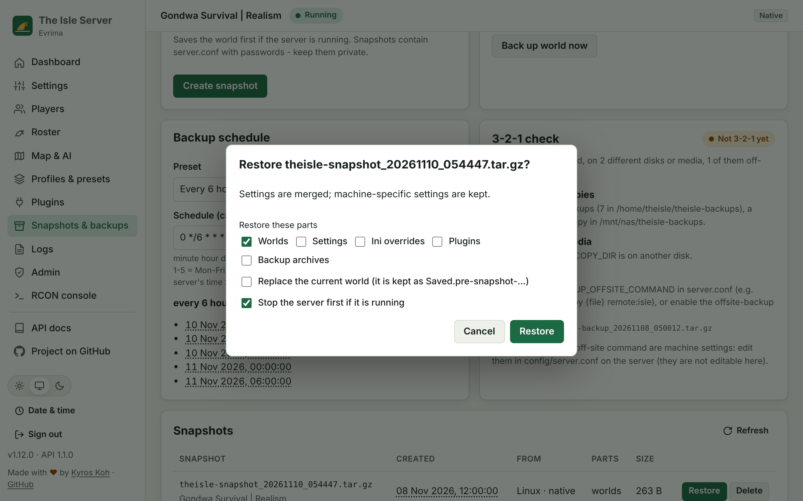

# Switching, cloning and migrating

There are two tools, and both use the same snapshot engine (`tools/isle_snapshot.py`), so they behave the
same on Linux and Windows, natively and in Docker:

| You want to... | Use |
|---|---|
| Switch this machine between **native** and **Docker** | The installer with `--data copy\|move\|fresh` (below) |
| Move or clone the server to **another machine or OS** (or keep a portable copy) | `snapshot create` on the old machine, then `--from-snapshot` or `snapshot restore` on the new one |

## What can be carried

| Part | Contents | Notes |
|---|---|---|
| `worlds` | `TheIsle/Saved` (without Logs/Crashes) | Never overwrites an existing world unless you pass `--overwrite`. The old world is then kept as `Saved.pre-snapshot_<yyyymmdd_hhmmss>` |
| `backups` | Backup archives | Existing files with the same name are kept |
| `settings` | `server.conf` | **Merged**, without machine-specific keys: paths, `RUNTIME`, `DOCKER_IMAGE`/`DOCKER_BUILD`, `PUID`/`PGID`, `MULTIHOME_IP`, `UI_HOST`/`UI_PORT`. Add `--all-settings` to take everything. The current file is backed up first |
| `overrides` | `config/overrides/*.ini` | Replaced files are kept as `.bak` |
| `plugins` | Plugin settings, enabled list, installed plugin code | Restoring plugin code warns that plugins run with the server user's rights |

Default: `worlds,settings,overrides,plugins`. `all` adds backups.

## Switching mode on the same machine

Re-run the installer with the other mode, and choose what happens to the data:

| `--data` | Effect |
|---|---|
| `copy` (default) | Carries the chosen parts into the new mode. The old mode's data stays where it is |
| `move` | Like copy, then clears the old mode's **worlds** (and **backups**, if carried), but only the parts that were actually restored. The snapshot used is kept in the new install's `snapshots/` folder as a safety copy |
| `fresh` | Carries nothing. The new mode starts with a new world, and the old data is kept |

```bash
sudo ./linux/install.sh --docker                                     # native -> docker, copy (default)
sudo ./linux/install.sh --docker --data move --carry worlds,backups  # move worlds + backups
sudo ./linux/install.sh --native --data fresh                        # docker -> native, start a new world
sudo ./linux/install.sh --native --carry worlds --overwrite          # take the Docker world even if native has one
```

```powershell
.\windows\Install.ps1 -Docker -Data Move
.\windows\Install.ps1 -Native -Data Fresh
.\windows\Install.bat -Native -Carry worlds,backups -Overwrite
```

On Windows both modes share one config folder, so settings, overrides and plugins are always shared, and
`-Carry` covers `worlds` and `backups`.

The old mode is always stopped and disabled before the copy, so the data is consistent. With no flag the
installer works as before: a switch carries the default parts, and a same-mode reinstall only picks up a
world the other mode left behind.

## Moving to another machine or OS (or cloning)

**1. On the old machine**, take a snapshot. If the server is running, it saves first.

```bash
sudo -u theisle isle-server snapshot create                    # native Linux
sudo isle-server snapshot create --include all                 # docker mode, including backups
```
```powershell
.\IsleServer.ps1 Snapshot create --output D:\theisle-snapshot.tar.gz   # Windows (or Manage.bat Snapshot create)
```

Snapshots go to the `snapshots/` folder next to the scripts by default (or `--output FILE`). They're mode
600 because they contain `server.conf` with passwords.

**2. Copy the file** to the new machine (scp, USB drive, cloud storage...).

**3. On the new machine**, install straight from the snapshot, in either mode:

```bash
sudo ./linux/install.sh --docker --from-snapshot theisle-snapshot_20261108_120000.tar.gz
sudo ./linux/install.sh --native --from-snapshot theisle-snapshot_20261108_120000.tar.gz --start
```
```powershell
.\windows\Install.ps1 -Native -FromSnapshot C:\Users\me\Downloads\theisle-snapshot_20261108_120000.tar.gz
```

Or restore into an existing install:

```bash
isle-server snapshot info  theisle-snapshot_...tar.gz          # what's inside, where it came from
isle-server snapshot restore theisle-snapshot_...tar.gz --stop # --stop stops the server first
isle-server snapshot restore theisle-snapshot_...tar.gz --include worlds --overwrite
```

The game files are never part of a snapshot. The new machine downloads them with SteamCMD (or the Docker
image does), and the world goes on top.

**Cloning** is the same procedure on a machine you keep. To clone into the other runtime on the **same**
machine, use `--data copy` (above), or restore a snapshot after reinstalling in the other mode.

## Commands

| Linux | Windows |
|---|---|
| `isle-server snapshot create [--include LIST] [--output FILE] [--no-save]` | `IsleServer.ps1 Snapshot create ...` |
| `isle-server snapshot restore FILE [--include LIST] [--overwrite] [--all-settings] [--stop]` | `IsleServer.ps1 Snapshot restore FILE ...` |
| `isle-server snapshot info FILE` / `list` | `IsleServer.ps1 Snapshot info FILE` / `list` |

The optional [web UI](UI.md) can create, restore and delete snapshots on its **Snapshots & backups** page:

| Snapshots | Restore |
|---|---|
|  |  |

Installer options: `--data copy|move|fresh`, `--carry LIST`, `--overwrite`, `--from-snapshot FILE`,
`--image REF` (use a prebuilt Docker image). Windows: `-Data`, `-Carry`, `-Overwrite`, `-FromSnapshot`, `-Image`.

## Safety

- A world is never overwritten unless you ask, and a replaced world is kept as `Saved.pre-snapshot_<yyyymmdd_hhmmss>`.
- `move` only clears what was actually restored, and keeps the snapshot as a safety copy.
- Restore refuses to run while the server is running (or stops it with `--stop`). It also refuses archives
  with absolute paths, `..`, links or an unknown format version.
- Restored files on a native Linux install belong to the service user.

---

Made with ❤️ by [Kyros Koh](https://github.com/kyroskoh)
