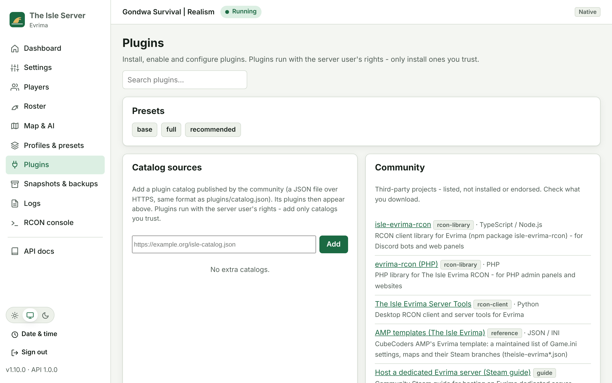
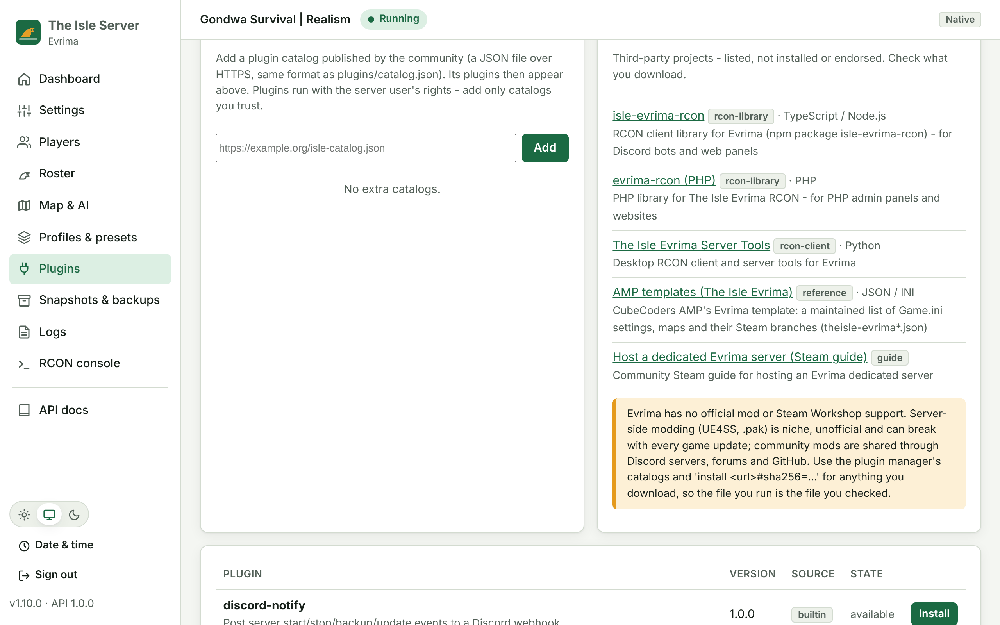

# Plugins

Plugins add server chores to the launcher: scheduled restarts with in-game warnings, Discord alerts,
off-site backup copies, and more. They work on Linux and Windows, natively and in Docker.

> **About game mods:** as far as we know, *The Isle - Evrima* has **no official mod or workshop support**,
> so this project doesn't ship a mod catalog. The plugin manager handles **server-toolkit plugins**
> (first-party and from catalogs you add yourself). A `files` plugin type can copy files such as a `.pak`
> into the game folder, but that is **untested with Evrima** and may be rejected by the game.

Requirements: Python 3.6+ on the machine that runs the launcher (Linux: installed by `install.sh`;
Windows: `Install.ps1` installs it with winget when it can).

The optional [web UI](UI.md) has a **Plugins** page for the same tasks:



## Commands

Linux: `isle-server plugins <command>`. Windows: `IsleServer.ps1 Plugins <command>` or `Manage.bat Plugins <command>`.

| Command | What it does |
|---|---|
| `list [--installed\|--available]` | Installed and available plugins, with version and enabled state |
| `search <text>` | Search every catalog (name, description, tags) |
| `info <name>` | Details, hooks, commands and settings (secrets masked) |
| `install <name\|folder\|archive\|url#sha256>` | Install and enable it, and create its settings file |
| `remove <name> [--purge]` | Uninstall it. `--purge` also deletes its settings |
| `enable <name>` / `disable <name>` | Turn a plugin's hooks on or off |
| `update [name]` | Update one or all plugins when the catalog has a newer version |
| `preset [name]` | List presets, or install and enable one |
| `run <name> [command] [args]` | Run a plugin command (default `run`) |
| `config <name> [KEY=VALUE ...]` | Show or change settings |
| `sources [add\|remove <url>]` | Manage extra catalogs |

## Presets

| Preset | Plugins |
|---|---|
| `base` | restart-countdown |
| `recommended` | restart-countdown, discord-notify, offsite-backup |
| `full` | restart-countdown, discord-notify, offsite-backup, welcome-announcer |

```bash
sudo -u theisle isle-server plugins preset recommended
sudo -u theisle isle-server plugins config discord-notify DISCORD_WEBHOOK_URL=https://discord.com/api/webhooks/...
sudo -u theisle isle-server plugins config offsite-backup DEST_DIR=/mnt/nas/theisle KEEP=30
```

## First-party plugins

| Plugin | Hooks / commands | Settings |
|---|---|---|
| **restart-countdown** | `run [minutes]` | `WARNINGS` (`15,10,5,1`), `MESSAGE` (`{minutes}`), `FINAL_MESSAGE` |
| **discord-notify** | post-start, pre-stop, post-stop, post-backup, post-update; `test` | `DISCORD_WEBHOOK_URL` (secret), `EVENTS`, `USERNAME` |
| **offsite-backup** | post-backup; `run` | `DEST_DIR`, `KEEP` (`14`), `COMMAND` (e.g. `rclone copy {file} remote:theisle`) |
| **welcome-announcer** | post-start (waits in the background); `run` | `MESSAGE` (`{name}`), `DELAY_SECONDS` (`180`) |

### Scheduled restarts

**Linux (cron, as root):**

```cron
0 6 * * *  sudo -u theisle /usr/local/bin/isle-server plugins run restart-countdown
```

Docker mode: `0 6 * * * /usr/local/bin/isle-server plugins run restart-countdown`.

**Windows (Task Scheduler):** create a daily task that runs
`powershell.exe -NoProfile -ExecutionPolicy Bypass -File C:\TheIsle\scripts\windows\IsleServer.ps1 Plugins run restart-countdown`.

## Hooks

The launcher runs the hooks of **enabled** plugins after the matching launcher action:

| Event | When |
|---|---|
| `post-start` | after `start` / `restart` |
| `pre-stop` | before `stop` / `restart` (when the server is running) |
| `post-stop` | after `stop` / `restart` |
| `post-backup` | after `backup` |
| `post-update` | after `update` / `validate` |

Hooks fire for actions started through the launcher (including `restart-countdown`). They don't fire when
systemd, Task Scheduler or Docker restart the server on their own. A failing hook prints a warning and
never blocks the server.

## Writing a plugin

A plugin is a folder with `plugin.json` and Python files:

```json
{
  "name": "my-plugin",
  "version": "1.0.0",
  "description": "What it does",
  "hooks": {"post-start": "plugin.py"},
  "commands": {"run": "plugin.py"},
  "settings": {
    "MY_SETTING": {"default": "x", "description": "Shown by 'plugins info'", "required": false, "secret": false}
  }
}
```

The entry point receives the event or command as its first argument. Settings arrive as environment
variables, together with `ISLE_EVENT`, `ISLE_CONF`, `ISLE_LAUNCHER`, `ISLE_RUNTIME` and `ISLE_PLUGIN_DIR`.
The helper library [`tools/isle_sdk.py`](tools/isle_sdk.py) is on `PYTHONPATH`:

```python
import sys
import isle_sdk as isle

def main(argv):
    isle.rcon("announce", "Hello from " + isle.conf("SERVER_NAME"))
    isle.log("done, setting=" + isle.setting("MY_SETTING"))
    return 0

sys.exit(main(sys.argv[1:]))
```

Install your own plugin from a folder or archive: `isle-server plugins install ./my-plugin`.

## Community resources and catalogs

`isle-server plugins community` (Windows: `Manage.bat Plugins community`), and the **Community** card on the web UI's
Plugins page, list community tools, libraries and guides from `plugins/community.json`: Evrima RCON libraries for
Node.js and PHP, an RCON desktop client, CubeCoders' AMP templates and a hosting guide. They are third-party projects:
listed with checked links, not installed or endorsed.

**Mods:** Evrima has no official mod or Steam Workshop support. Server-side modding (UE4SS, `.pak`) is niche,
unofficial and can break with every update, and community mods are shared through Discord servers, forums and GitHub.
For anything you download, use a catalog entry with a `sha256`, or `plugins install <url>#sha256=<hex>`, so the file
you run is the file you checked.

Community catalogs (below) can also be added from the web UI (**Plugins → Catalog sources**), and their plugins then
appear in the list. Only https:// URLs are accepted there.



## Third-party catalogs

A catalog is a JSON file served over HTTP(S):

```json
{
  "catalog": "example",
  "plugins": [
    {"name": "their-plugin", "version": "1.2.0", "description": "...", "tags": ["discord"],
     "url": "https://example.org/their-plugin-1.2.0.tar.gz",
     "sha256": "<64 hex characters>"}
  ],
  "presets": {"their-preset": ["their-plugin"]}
}
```

```bash
isle-server plugins sources add https://example.org/catalog.json
isle-server plugins search discord
isle-server plugins install their-plugin
```

Safety rules:
- **SHA-256 is mandatory** for downloads (catalog `sha256`, or `url#sha256=<hex>` on the command line). A mismatch is refused.
- **Archives** (`.zip`, `.tar.gz`) with absolute paths, `..` entries or links are refused.
- **First-party names win:** a third-party catalog can't replace a first-party plugin with the same name.
- **Warning:** installing third-party code prints a warning. **Plugins run with the server user's rights.**
  Add only catalogs and plugins you trust.

### File add-ons (experimental)

A plugin with `"type": "files"` and a `files` list copies files into the server folder on install (native mode):

```json
{"name": "my-pak", "version": "1.0.0", "type": "files",
 "files": [{"src": "MyMod.pak", "dest": "TheIsle/Content/Paks/~mods/MyMod.pak"}]}
```

Destinations can't leave the server folder. **This is untested with Evrima**, which has no official mod
support, and may be rejected by the game or anti-cheat. In docker mode, copy files with `docker cp` instead.

## Files

| Path | Contents |
|---|---|
| `plugins/catalog.json` | First-party catalog and presets |
| `plugins/available/<name>/` | First-party plugins |
| `plugins/installed/<name>/` | Installed plugins |
| `config/plugins/enabled.txt` | Enabled plugins |
| `config/plugins/<name>.conf` | Plugin settings (mode 600) |
| `config/plugins/sources.txt` | Extra catalogs |
