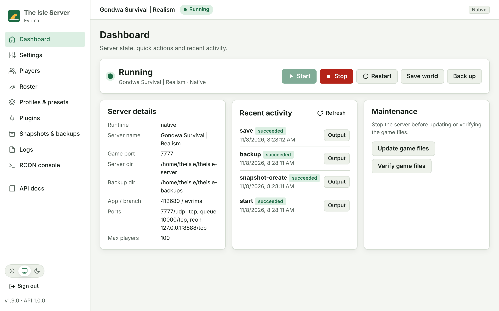

# The Isle (Evrima) Dedicated Server Scripts

Scripts to install, configure, run, update and back up a **The Isle – Evrima**
dedicated server on **Windows**, **Linux** and **Docker**, all driven from one shared config file.

| Platform | Supported | Entry point |
|---|---|---|
| Windows 10 / 11 (x64) | ✅ | `windows\Install.bat` |
| Windows Server 2019 / 2022 / 2025 (Desktop or Core) | ✅ | `windows\Install.bat` |
| Debian / Ubuntu / Mint / Pop!_OS | ✅ | `sudo linux/install.sh` |
| Fedora / RHEL / Rocky / Alma / CentOS Stream | ✅ | `sudo linux/install.sh` |
| Arch / Manjaro / EndeavourOS | ✅ (enables `[multilib]`) | `sudo linux/install.sh` |
| openSUSE Leap / Tumbleweed / SLES | ✅ | `sudo linux/install.sh` |
| Other glibc x86_64 distros | ⚠️ Manual dependencies | `linux/isle-server.sh install` |
| Docker / Docker Desktop (x86_64 host) | ✅ | `docker compose up -d` |
| Alpine / musl, ARM | ❌ Not supported (the server is x86_64 glibc only) | — |

<picture>
  <source media="(prefers-color-scheme: dark)" srcset="docs/images/ui/dashboard-dark.png">
  
</picture>
<p align="center"><sub>The optional web UI (<code>isle-server ui</code> / <code>UI.bat</code>) follows your light or dark theme. More screenshots in <a href="UI.md">UI.md</a>.</sub></p>

## Features

- **One config for both OSes.** `config/server.conf` produces `Game.ini` and `Engine.ini` for you.
- **Native or Docker, same launcher.** Set `RUNTIME=docker` (or pass `--docker` / `-Runtime Docker`) and the same commands and `.bat` files manage a container instead.
- **Switch, clone and migrate.** Switch native <-> Docker by reinstalling with `--data copy|move|fresh` and `--carry worlds,backups,settings,overrides,plugins`. **Portable snapshots** move or clone a server to another machine or OS, in either runtime, with `snapshot create` and then `--from-snapshot`. See [MIGRATION.md](MIGRATION.md).
- **Every Game.ini / Engine.ini key** through override files, an annotated key reference, **7 profiles** (realism, casual, hardcore-pvp, ...), **22 stackable presets**, and **roster presets**.
- **Admin, whitelist and roster commands** (`admins`, `whitelist`, `classes`, `ai-classes`) with SteamID and class validation. Whitelist and roster changes apply live over RCON.
- **Plugin manager** with search, install, update and presets (base, recommended, full). First-party plugins: scheduled restart countdown, Discord notifications, off-site backups, welcome announcement. Third-party catalogs must be SHA-256-pinned. See [PLUGINS.md](PLUGINS.md).
- **Config validation.** `check` catches bad ports, typos in true/false values, a missing RCON password and malformed SteamIDs before the server launches.
- **Installers with two modes, native or Docker** (you choose, or pick at the prompt). They set up dependencies, SteamCMD, the server (Steam app `412680`, branch `evrima`), firewall rules and a boot-time service, or a container. Re-run them to update or to switch modes. **Uninstall lets you choose** what to keep: everything (default), everything except the re-downloadable game files, no worlds, or nothing. A later reinstall in either mode picks it up again, importing it from the other mode if needed. `--purge` wipes everything.
- **Optional web UI and REST API** (`isle-server ui`, `UI.bat`, or at boot with `install.sh --ui` / `Install.bat -UI`).
  Dashboard, settings, players, roster, profiles, plugins, snapshots, logs and an RCON console, with light/dark/system
  themes. The OpenAPI 3.1 docs at `/docs` have a "Try it" form. It listens on localhost only and needs a token. See [UI.md](UI.md).
- **Launchers** for start, stop, restart, status, logs and a console mode.
- **Watchdog** that restarts the server if it crashes. On Linux this is systemd `Restart=on-failure` or the built-in watchdog. On Windows it's a scheduled task plus a watchdog loop.
- **Auto-update** through SteamCMD before each start (optional).
- **Graceful stop.** The scripts save the world over RCON, then stop the server cleanly.
- **Backups** run daily, keep a set number of copies, and can be restored.
- **RCON client** (`tools/isle_rcon.py`). It's pure Python and runs on both OSes: announce, kick, ban, save, playerlist, whitelist and more.
- **Least privilege.** On Linux the server runs as a dedicated `theisle` user. On Windows it runs as `LOCAL SERVICE`.

## Quick start

### Windows

1. Download or clone this repository.
2. Double-click **`windows\Install.bat`**, accept the Administrator prompt, and choose **1** (native) or **2** (Docker Desktop).
3. Edit **`C:\TheIsle\scripts\config\server.conf`**: set the server name, admins and so on.
4. Run **`C:\TheIsle\scripts\windows\Restart.bat`**, or reboot. The server starts at boot.

### Docker (same launcher)

```bash
git clone https://github.com/kyroskoh/the-isle-dedicated-server.git
cd the-isle-dedicated-server
sudo ./linux/install.sh --docker --start      # Linux
# Windows: windows\Install.bat -Docker -Start  (Docker Desktop, Linux containers)
```

After that, use the same commands as a native install. See [DOCKER.md](DOCKER.md).

### Linux

```bash
git clone https://github.com/kyroskoh/the-isle-dedicated-server.git
cd the-isle-dedicated-server
sudo ./linux/install.sh            # asks: 1 = native, 2 = docker (or pass --native / --docker); add --start
sudo nano /home/theisle/theisle-scripts/config/server.conf
sudo systemctl restart theisle-server
```

Then forward these ports on your router or cloud firewall:

| Port | Protocol | Purpose | Expose publicly? |
|---|---|---|---|
| 7777 | UDP (+TCP) | Game traffic | **Yes** |
| 10000 | TCP | Join queue | **Yes** (if queue enabled) |
| 8888 | TCP | RCON | **No.** Keep it private or behind a VPN |

## Everyday commands

| Task | Linux | Windows |
|---|---|---|
| Start | `sudo systemctl start theisle-server` or `isle-server start` | `Start.bat` / `IsleServer.ps1 Start` |
| Stop (saves first) | `sudo systemctl stop theisle-server` or `isle-server stop` | `Stop.bat` |
| Restart | `isle-server restart` | `Restart.bat` |
| Status | `isle-server status` | `Status.bat` |
| Follow the log | `isle-server logs -f` | `IsleServer.ps1 Logs -Follow` |
| Update the game | `isle-server stop && isle-server update && isle-server start` | `Stop.bat`, then `Update.bat`, then `Start.bat` |
| Backup | `isle-server backup` | `Backup.bat` |
| Restore | `isle-server restore <file.tar.gz>` | `Restore.bat -Path <file.zip or .tar.gz>` |
| Reinstall / switch mode | `sudo ./linux/install.sh [--native\|--docker]` | `Install.bat [-Native\|-Docker]` |
| Uninstall: keep / choose / purge | `sudo ./linux/install.sh --uninstall` (asks), `--keep-data`, `--remove-game-files`, `--remove-worlds`, `--purge` | `Install.bat -Uninstall` (asks), `-KeepData`, `-RemoveGameFiles`, `-RemoveWorlds`, `-Purge` |
| RCON announce | `isle-server rcon announce "Restart in 5 min"` | `IsleServer.ps1 Rcon -RconArgs announce,'Restart in 5 min'` |
| Check the config | `isle-server check` | `IsleServer.ps1 Check` |
| Apply a profile / presets | `isle-server profile apply realism`, `isle-server preset apply ai-low short-nights` | `Manage.bat Profile apply realism` |
| Admins / whitelist | `isle-server admins add <id>`, `isle-server whitelist add <id>` | `Manage.bat Admins add <id>`, `Manage.bat Whitelist add <id>` |
| Playable roster | `isle-server classes preset carnivores`, `isle-server classes add Triceratops` | `Manage.bat Classes preset carnivores` |
| Plugins | `isle-server plugins preset recommended` | `Manage.bat Plugins preset recommended` |
| Snapshot (move/clone) | `isle-server snapshot create`, `isle-server snapshot restore <file>` | `Manage.bat Snapshot create` |
| Switch mode, keep/move data | `sudo ./linux/install.sh --docker --data move` | `Install.bat -Docker -Data Move` |
| New machine from a snapshot | `sudo ./linux/install.sh --native --from-snapshot <file>` | `Install.bat -Native -FromSnapshot <file>` |
| Web UI + API (optional) | `sudo -u theisle isle-server ui` (token: `isle-server ui-token`) | `UI.bat` (token: `Manage.bat UiToken`) |
| Web UI at boot | `sudo ./linux/install.sh --ui` | `Install.bat -UI` |
| Re-generate ini | `isle-server configure` | `IsleServer.ps1 Configure` |
| Paths & settings | `isle-server info` | `IsleServer.ps1 Info` |
| Script version | `isle-server version` | `IsleServer.ps1 Version` |

On Linux, run `isle-server` as the service user: `sudo -u theisle isle-server <cmd>`.
With `RUNTIME=docker` the **same commands** manage the container. Run them as a user who can use Docker (`sudo isle-server <cmd>`).
To override the runtime per command, use `isle-server --docker|--native <cmd>` or `IsleServer.ps1 <Cmd> -Runtime Docker|Native`.

## Repository layout

```
config/server.conf.example   Shared settings (copied to server.conf by the installers)
linux/install.sh             Root installer: deps, user, SteamCMD, server, firewall, systemd
linux/isle-server.sh         Manager: install/update/start/stop/status/logs/backup/rcon ...
windows/Install.ps1 (.bat)   Elevated installer: VC++ runtime, SteamCMD, server, firewall, task
windows/IsleServer.ps1       Manager with the same commands as the Linux script
windows/*.bat                Double-click launchers (Start, Stop, Restart, Update, Backup, ...)
tools/isle_rcon.py           Cross-platform Evrima RCON client
tools/isle_plugins.py        Plugin manager (+ tools/isle_sdk.py for plugin authors)
tools/isle_api.py            REST API + web UI server (OpenAPI 3.1 at /openapi.json, docs at /docs)
ui/                          Web UI pages (vanilla HTML/CSS/JS, no external assets)
plugins/                     Plugin catalog and first-party plugins
config/profiles|presets/     Play-style profiles and stackable presets
config/rosters/, classes.txt Roster presets and known class names
config/overrides/            Your Game.ini / Engine.ini overrides (examples in config/examples/)
config/reference/            Annotated Game.ini / Engine.ini key reference
docker/                      Dockerfile, entrypoint and exec wrapper
docker-compose.yml           Compose service (ports, volume, env settings)
```

## Documentation

- [INSTALL.md](INSTALL.md): step-by-step installation, manual installs, and uninstalling
- [DOCKER.md](DOCKER.md): running in Docker / Docker Compose
- [MIGRATION.md](MIGRATION.md): switching native <-> Docker with data choices, and snapshots to move or clone a server across machines and OSes
- [UI.md](UI.md): the optional web UI and REST API (OpenAPI docs at `/docs`)
- [PLUGINS.md](PLUGINS.md): the plugin manager, first-party plugins, writing plugins, third-party catalogs
- [CONFIGURATION.md](CONFIGURATION.md): every `server.conf` key and the `Game.ini` key it maps to
- [TROUBLESHOOTING.md](TROUBLESHOOTING.md): common problems and fixes
- [PRD.md](PRD.md): product requirements, plan and traceability (start here before contributing)
- [CHANGELOG.md](CHANGELOG.md): release history
- [SECURITY.md](SECURITY.md): hardening advice
- [CONTRIBUTING.md](CONTRIBUTING.md): how to contribute
- [LICENSE.md](LICENSE.md): MIT

## References

- Setup approach based on the community guide
  [How to set up a The Isle Evrima dedicated server (XGamingServer)](https://xgamingserver.com/blog/how-to-set-up-a-the-isle-evrima-dedicated-server/).
- [SteamCMD documentation (Valve Developer Wiki)](https://developer.valvesoftware.com/wiki/SteamCMD)

## Disclaimer

This is a community project. It is not affiliated with or endorsed by Afterthought LLC
(the developers of The Isle) or by Valve. "The Isle" is a trademark of its owners. Game
settings change between Evrima updates. If a key stops working, check the official
patch notes and adjust `server.conf` (or use `EXTRA_GAME_SESSION_SETTINGS`).
